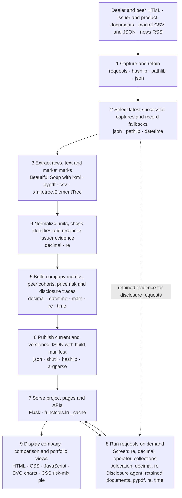

# IPO-Ready prototype report and client playbook

**24 November 2026 · Local prototype build `20261123T191506Z`**

IPO-Ready brings together financial disclosures, peer context and a whole-lot portfolio scenario for Indian unlisted shares. The current build supports an internal walkthrough. Demo sign-off depends on correcting Polymatech’s FY2025 profit mapping and clarifying the scope and source of IGX’s quick-ratio inventory assumption. The portfolio cases use dated prices and stated stress assumptions. [Frozen build manifest](../../../../site/data/builds/20261123T191506Z/manifest.json) · [Independent review](../starter-kit/REVIEW.md)

## 1. Problem Statement

An Indian retail investor considering a dealer-quoted unlisted share needs to make two decisions. The first is whether the evidence warrants more diligence. The second is whether one available lot could fit a budget such as ₹5 lakh without consuming too much capital or creating concentrated exposure.

Dealer pages, issuer filings and listed-peer data answer different parts of that question. A dealer page can supply an indicative price without disclosing execution terms. An issuer’s draft red herring prospectus (DRHP) or restated statements may give a clearer financial perimeter, while secondary financial tables can leave the reporting basis unstated. Inventory and non-performing assets (NPAs) require business-specific interpretation because the same blank cell can represent an undisclosed value, an inapplicable field or an extraction gap.

The prototype links the company view, peer screen and scenario lab so an investor can trace the evidence before acting on a ratio or modeled allocation. The IGX case tests the two decisions separately because the issuer has useful primary disclosures and the quoted minimum lot is material relative to a ₹5 lakh budget. [Prototype brief](../starter-kit/PROTOTYPE_BRIEF.md) · [IGX research record](../../../../docs/research/sources/N13.md)

## 2. Similar research already done in that area

### Academic precedents

| Study | Finding relevant to IPO-Ready | Implication for this prototype |
| --- | --- | --- |
| Joseph Piotroski, *Value Investing* (2000) | Combines accounting signals for profitability, financial strength and efficiency in a historical high book-to-market sample. [Paper](https://www.ivey.uwo.ca/media/3775523/value_investing_the_use_of_historical_financial_statement_information.pdf) | Keep components and missing states visible. Any composite score for Indian unlisted issuers would need its own point-in-time population and validation. |
| Moonchul Kim and Jay Ritter, *Valuing IPOs* (1999) | Examines IPO valuation using comparable firms. Unadjusted comparable multiples had modest predictive ability in the authors’ sample. [Paper](https://site.warrington.ufl.edu/ritter/files/2015/10/Valuing-IPOs-1998-08-18.pdf) | Use the peer multiples as descriptive context after an eligibility check. Differences in pricing date, earnings basis and business mix limit the valuation inference. |
| Zhiyu Chen and colleagues, *FinQA* (2021) | Links financial questions to annotated numerical reasoning programs. [Proceedings paper](https://aclanthology.org/2021.emnlp-main.300/) | Make calculations and source operands inspectable. The local disclosure agent exposes a trace and page anchors, and Python handles the arithmetic. |

### Product and analyst precedents

Screener.in’s annual statements and Boolean queries shaped the search syntax. WWIPL supplied retained unlisted quotes and financial tables for this build. The UnlistedZone probe illustrated source access and coverage risk. The prototype preserves reported units, separate listing observations and issuer reconciliation because secondary records can disagree with the underlying company evidence. Crunchbase’s separate funding and IPO filters informed the distinction between a company’s market status and its financial reporting basis. [Free-source assessment](../../../../docs/research/topics/unlisted-free-data.md) · [Crunchbase source review](../../../../docs/research/sources/N17.md)

Two broker-note examples show why sector context matters. Lending analysis uses asset quality and funding measures. Exchange analysis needs to consider volumes, transaction income and settlement balances. That distinction informs the agent’s applicability rules and the interpretation of exchange cash flow. The Moneycontrol endpoint tested for market data returned no data in the prototype probe. The build uses official NSE end-of-day files for covered indices and equities, with a separate delayed source for Sensex. [Analyst-method review](../../../../docs/research/topics/expert-analysis-pipeline.md) · [Market-source decision](../starter-kit/WORKING_STATE.md#decisions-reversible-unless-noted)

## 3. Data Sources, Data Quality, and Data Information

### Source coverage and dates

| Source | Access | Fields | Evidence type | Units / period | Freshness |
| --- | --- | --- | --- | --- | --- |
| WWIPL company overview and financial pages (`data/captures/wwipl/<run>/`) | Public HTML, bounded capture, SHA-256 per file | Dealer quote, share details, listing labels, balance sheet, P&L, cash flow and provider ratios | Secondary dealer data | INR crore, lakh, thousand or million as labelled | Retained captures from 23 Nov 2026. Annual coverage varies. Quote capture time dates the observation of the page. [Expansion captures](../../../../docs/research/sources/N14.md) |
| IGX investor-relations documents (`data/captures/issuer/`) | Public PDFs | Restated Financial Information FY24–26 (59 pp, auditor's examination report), DRHP (469 pp), abridged prospectus | Primary issuer | INR million; years ended 31 March | Restated statements dated 14 July 2026; retrieved 2026-11-23 |
| NSE Indices end-of-day file and equity bhavcopy (`data/captures/nse_eod/store/`) | Official public CSV archives | Index close, change, P/E and P/B. Equity close, turnover and delivery percentage. | Official exchange | Index points, INR and INR lakh by field | 67 trading dates in the build. Latest retained close is 23 Nov 2026. |
| Yahoo Finance chart JSON (`data/captures/yahoo/`) | Retained responses from unofficial endpoint | Sensex daily and intraday series, plus Nifty intraday | Delayed third-party | Index points, timestamped in IST | Captured 23 Nov 2026 at 16:51 UTC. |
| Google News RSS (`data/captures/news/`) | Public RSS | Headline, publisher, publication date and link | Third-party headline metadata | Dates | Captured 23 Nov 2026. Selected separately retained disclosures and reporting are reviewed below. |
| Screener.in company pages (`data/captures/screener/`) | Public HTML | Annual sales or lending revenue, earnings, balance-sheet values, provider ROCE and business profiles | Secondary | INR crore, INR per share and % | 68 pages audited for 34 symbols. 62 supplied annual rows with identifiable basis. [Initial audit](../../../../docs/research/sources/N11.md) · [New captures](../../../../docs/research/sources/N14.md) |
| Primary annual statements for CIAL and Automotive Axles | Retained issuer PDF and exchange-hosted rendered filing | Exact annual revenue, profit, other income and EPS rows | Primary | INR lakh or INR per share; March 2026 | Opened and retained 23 Nov 2026. [N15](../../../../docs/research/sources/N15.md) |
| Selected company plans and one article | Retained public sources | Dated paraphrases with a document location and source link | Company disclosure and publisher reporting | Source and capture dates | Six reviewed updates. RSS links remain labelled headline-only. [N16](../../../../docs/research/sources/N16.md) |
| Portfolio instrument terms | Retained RBI HTML, fund PDF and NSE circular | Coupon, term, exit conditions, gold exposure and MCX split | Primary regulator, fund and exchange documents | % p.a., INR, years, split factor and effective date | RBI coupon applies July–December 2026. Gold note is October 2026. Split effective 2 January 2026. [RBI](../../../../docs/research/sources/N18.md) · [Gold BeES](../../../../docs/research/sources/N19.md) · [NSE](../../../../docs/research/sources/N20.md) |

### Value states and quality checks
`reported`, `explicit_zero`, `dash` (provider "–"), `blank`, `provider_error` (`#DIV/0!`), `derived` (summed from listed lines), `not_in_source`, plus metric states `missing_input`, `zero_denominator`, `negative_base`, `inapplicable` and `suspect_quote`. Raw label, raw text, raw unit, column label, basis and table/row anchor are stored with every observation.

The offline build stores 25 company records and 31 JSON artifacts. Its manifest shows **146 checks passed, two failed, six conflicts and one stale flag**. The independent review later identified two specific gaps in the existing automated coverage. [Build manifest](../../../../site/data/builds/20261123T191506Z/manifest.json) · [Review findings](../starter-kit/REVIEW.md#severity-ranked-findings)

- **Balance identity:** assets equal equity plus liabilities, with exchanges' Core Settlement Guarantee Fund treated as its own block. Fails for OYO FY2022 (₹298.74 cr gap) and HDFC Securities FY2026 (₹0.94 cr); both are kept as provider inconsistencies.
- **Income identity.** The expected total includes separate gains or job-work revenue where reported. Axles India and Group Pharmaceuticals reconcile after retaining those lines. The two different FY2026 Group Pharmaceuticals rows labelled Profit for the Year are preserved as a conflict, and the ambiguous PAT is withheld. [Provider captures](../../../../docs/research/sources/N14.md)
- **Share-count consistency:** IGX's "fundamentals" share count of 75,000,000 equals authorised capital (₹75 crore ÷ ₹10). The dated share-details figure of 74,030,400 is used, and it matches the issuer's paid-up capital of ₹740.30 mn ÷ ₹10. NSE's summary share count is in crore units (247.5); it is detected as a more-than-100× unit mismatch and not used.
- **IPO status conflict:** the provider shows "DRHP Filed? No", but IGX's own investor page links a DRHP.
- **IGX reporting scope.** The FY2024–FY2026 restated figures cover IGX and its employee share trust. IGX became an associate of promoter IEX on 17 January 2022. Page 1 displays the restated scope alongside the reconciliation. WWIPL's own statement basis remains unspecified. [N13](../../../../docs/research/sources/N13.md)
- **Unlisted scope.** The demo has 24 off-exchange company choices across eight domains. Pharmed and GKN Driveline carry the provider's delisted label. The screener and discovery exclude NSE based on its issuer listing note, with the historical record retained. [N07 listing note](../../../../docs/research/sources/N07.md) · [N14 expansion](../../../../docs/research/sources/N14.md)
- **Quote sanity:** Haldia Petrochemicals' ₹0.10 quote implies a P/E of 0.02, so valuation is withheld.
- **Freshness.** The latest period earlier than FY2025 is flagged. Reliance Retail was the flagged record in this build.

### Issuer reconciliation (IGX)
The restated statements on pp5–7 were read with explicit line patterns, page titles were confirmed, and values were converted from ₹ million to ₹ crore (÷10):
- 36 of 45 comparisons match within the provider's 2-dp rounding.
- FY2026 and FY2024 match line for line, except FY2026 cash from operations (₹156.69 cr restated against ₹156.89 cr on WWIPL).
- For several FY2025 lines, the differences in statement amounts are ₹0.16–0.32 crore. The EPS difference is recorded per share. A pre-restatement provider source could explain the differences. The provider’s original source basis remains unresolved.

### Remaining gaps
The issuer-document bundle searched by the disclosure agent is concentrated on IGX. The peer comparison also has selected primary annual records, including CIAL and Automotive Axles. Basis and period coverage vary by company. The market views use retained closes and delayed chart data. A dealer quote and a source-listed lot size provide inputs for scenario sizing. Execution price, depth, transfer conditions and exit timing need separate evidence. [Source coverage review](../../../../docs/research/topics/listed-peer-coverage.md) · [Portfolio evidence](../../../../docs/research/topics/portfolio-instruments.md)

## 4. Overall Approach to solve the problem

**Journey.**
1. **Page 1** (home, `/`) opens on IGX. The investor reads the financial picture and gaps, opens any figure's source, runs the disclosure-gap agent, checks markets and news in the side rail, and follows a discovery lead to another unlisted company.
2. **Page 2** (`/compare.html`) opens a side-by-side annual comparison. Choose a domain and one of its companies, check the basis and candidate exclusions, inspect a value's operands, and review dated company plans or news. The same page runs the compound unlisted screen and links results back to their dashboards.
3. **Page 3** (`/portfolio.html`) opens on a ₹5 lakh balanced scenario. Change the amount, risk tolerance, unlisted company or inclusion setting. Compare whole-unit holdings and the low, medium and high risk mix against the baseline at the same amount and tolerance. The view links to the dealer evidence and exact scenario JSON.

**Source to dashboard.**
1. **Capture.** `ipo_ready/capture.py` makes explicit, bounded requests and writes native bytes, a manifest, status and SHA-256 per run. Failures are recorded, not raised.
2. **Select.** `sources.py` takes the latest good item per source; if the newest attempt failed, it falls back to the previous capture and records the fallback.
3. **Parse.** `parse_wwipl.py`, `parse_screener.py`, `issuer.py` and `peer_context.py` read observations with raw labels, units, periods and states. The context capture also retains primary company updates and publisher evidence. `portfolio.py` extracts the coupon from the dated RBI release and uses the verified NSE split date and ratio.
4. **Normalise.** `company.py` maps canonical fields, derives section totals, runs checks and reconciles against the issuer.
5. **Agent.** `agent.py` runs the disclosure-gap tools.
6. **Metrics.** `metrics.py` uses Decimal arithmetic with explicit states.
7. **Deliver.** `pipeline.py` writes `site/data/builds/<build_id>/` and copies it to `site/data/current/`, with a manifest of input runs, hashes, fallbacks, checks and code hash. `peers.json` caches the comparison results. `portfolio.json` publishes terms, sampled closes, price-risk metrics, source records and exit evidence.
8. **Serve.** Flask serves the pages, `/api/agent/disclosure`, `/api/screen` and `/api/portfolio/allocate`. Screener and allocation inputs are cached by local file revision. The allocation response identifies the data build and method version. The company-level and peer JSON files expose the retained evidence used by the browser.

The online command, `python -m ipo_ready.pipeline`, captures and builds. The `--offline` option uses retained files. The current offline build recorded **19.36 seconds** and zero source fallbacks. The independent review also simulated failures for WWIPL, IEX fundamentals, market data and the RBI coupon. The separate fallback build recorded seven source receipts and surfaced the retained data in the views. [Current manifest](../../../../site/data/builds/20261123T191506Z/manifest.json) · [Fallback manifest](../../../../site/data/builds/20261123T191215Z/manifest.json)

## 5. Detailed Analytics Methodology(ies)

### Page 1 metrics (implemented, `ipo_ready/metrics.py`)

| Metric | Formula | Edge cases |
| --- | --- | --- |
| Revenue growth | revenue from operations_t ÷ revenue_t−1 − 1 | Previous value zero → `zero_denominator`; negative base → `negative_base` |
| PAT margin | PAT ÷ total income | Missing operand → `missing_input` |
| Net profit ratio | PAT ÷ revenue from operations (the issuer's own definition) | — |
| Other-income share | other income ÷ total income | Explains exchange profit that comes from treasury income |
| Current ratio | current assets ÷ current liabilities | Lenders and insurers → `inapplicable` (no current/non-current split) |
| Quick ratio | (current assets − inventories) ÷ current liabilities | A reported inventory value is used. An `inapplicable` agent verdict can supply an assumed nil. Other missing inventory inputs withhold the ratio. The current IGX implementation reuses the issuer-level assumption across years, including periods outside the retained balance sheet. |
| ROE | PAT ÷ average of opening and closing equity | First period has no opening equity → `missing_input` |
| ROCE | (PBT + finance cost) ÷ (total assets − current liabilities) | The issuer's definition of capital employed is unstated, so results can differ (see §7) |
| CFO ÷ PAT | cash from operations ÷ PAT | For exchanges and brokers, a note explains settlement and margin flows |
| EPS proxy (Python) | PAT in crore × 10⁷ ÷ selected outstanding shares | Uses the selected PAT row and share count. The source priority is the dated share-details block, then the summary table, then fundamentals. Values with a more-than-100× discrepancy are rejected. Reported basic EPS can differ. |
| Market cap at quote | dealer quote × shares ÷ 10⁷ | Labelled indicative; withheld if the quote fails the sanity check |
| P/E at quote in the company view and screener | dealer quote ÷ calculated EPS proxy | Zero and negative earnings have explicit states. The listed-peer comparison has a separate reported-EPS method. See the threshold sensitivity in §7. |

For market charts, the Python pipeline samples weekly closes and flags candidate split factors when adjacent marks differ sharply. The portfolio method below uses a shared set of completed weeks and the explicitly verified MCX corporate action. Portfolio statistics and company market-rail statistics use different sampling rules. [Market code](../../../../ipo_ready/market.py) · [Portfolio source review](../../../../docs/research/topics/portfolio-instruments.md)

**Disclosure-gap agent** (`ipo_ready/agent.py`, deterministic) runs six tools in order:
1. **`provider_lookup`** checks whether the field is in the provider's parsed statements.
2. **`applicability_rule`** compares the business model against a rule table with a stated reason.
3. **`statement_line_check`** reads the issuer's restated balance sheet (p5) to see whether an "Inventories" line exists.
4. **`document_search`** runs word-boundary regex over every page of the retained PDFs. For comparison it also counts naive substring matches: "NPA" appears inside "COMPANY".
5. **`classify_passages`** sorts hits into numeric line item, numeric NPA disclosure, explicit not-applicable statement or narrative mention.
6. **`verdict`** reports a status, how to verify it and the next check.

### Page 2 unlisted screener (implemented)

- A condition consists of an allowed financial field, one of `> < >= <= =`, and a signed or unsigned decimal. Field names and connectors are case-insensitive. `AND` binds before `OR`. The query is limited to 500 characters and 12 conditions. See **Fields and units** for the supported names and aliases.
- Currency thresholds use ₹ crore, P/E and P/B use multiples, and ratios expressed as percentages use percentage points. For example, `ROCE > 22%` and `ROCE > 22` are equivalent. Python uses `Decimal` to compare the values published in the summary, at pipeline precision.
- A condition with a missing or withheld input is undecided. In an `AND` group a known false condition rules out the group, while a fully true `OR` branch can qualify a company even with gaps elsewhere. The screen distinguishes matches, definite non-matches and undecided companies. Coverage counts retain reasons such as negative earnings and suspect quotes.
- Matching rows show the queried metrics, each company's latest available fiscal period and provider basis, the dealer quote capture date when relevant, and a link to the supporting company dashboard. Mixed periods and bases are permitted for discovery. Same-period and same-basis eligibility for listed-peer comparison is a separate requirement.

### Page 2 listed-peer eligibility (implemented)

- Business fit comes from reviewed operating models. A related sector can provide context, with eligibility decided on how the business earns its revenue. The operating comparison also requires the exact same annual year-end, compatible verified statement bases, and usable operating revenue and PAT.
- The parser starts from annual P&L columns, excludes trailing twelve months and quarter-only balance sheet columns, and keeps the `(S)` and `(C)` column overrides. It records every chosen row's raw label, value, unit, basis, year-end, URL, capture time and SHA-256. The listed provider's ROCE is retained as evidence. Cross-company ROCE requires a shared capital-employed definition.
- IGX's reviewed restated basis includes its employee share trust. This is compatible with standalone statements for the narrow operating comparison. IEX standalone is the operating reference given the promoter and associate relationship. WWIPL data for IGX remains labelled as unspecified elsewhere. [Scope review](../../../../docs/research/sources/N13.md)
- **PAT ÷ operating revenue** uses annual PAT and reported operating revenue. Listed `Sales` or a lender's reported `Revenue` is the top-line proxy. PAT includes income outside operations and tax. Other-income share uses other income plus separately reported other gains, divided by operating revenue, job-work revenue, other income and other gains where those lines exist. Python uses Decimal and reports unavailable inputs separately.
- **Annual P/E** uses price ÷ reported annual EPS on the assessed basis. Annual EPS and PAT must both be positive, and the price must be dated on or after the year-end. Listed multiples use the latest annual EPS on the eligible page and an official retained close from the same Indian calendar date as the unlisted dealer quote. A detected post-year-end split withholds the comparison multiple pending an EPS adjustment. Share-basis verification beyond the observed split history remains a diligence item. IGX uses issuer-reported EPS here, while its company dashboard and screener use their existing Python EPS method.
- Python calculates percentage-point differences against the first eligible peer in the reviewed business-fit order. It caches those results with candidate reasons and source anchors. The page renders the cached values and opens raw evidence on demand. A domain groups companies for browsing, while each comparison applies its own eligibility gates.

### Page 3 portfolio inputs (implemented)

- For listed instruments, take the last retained close of each completed ISO week and align dates across the available instruments. Compute the sample standard deviation of adjacent weekly log price returns times √52. Require at least 40 adjacent returns. Skip any pair spanning a missing week. Sampled max drawdown is the worst closing price relative to the highest preceding sampled close. Both calculations exclude distributions. The ETF uses NSE prices, and drawdown can miss intraweek lows.
- The NSE listing circular confirms MCX's five-for-one split. Divide closes before 2 January 2026 by five and preserve the raw prices. A split candidate without evidence can prevent risk figures from being shown.
- Use latest available `CLOSE_PRICE` and `TURNOVER_LACS` from the same dated exchange file. Divide the turnover by 100 to show ₹ crore. One session's turnover gives trading context. Order depth, trading costs and exit capacity require additional evidence.
- The RBI coupon is an annual before-tax cash-flow term for the cited half-year. The bond's seven-year lockup and early redemption restrictions require separate treatment. The bond and unlisted holdings have no verified exchange price series for volatility or drawdown. Dealer quotes are indicative and their date is the provider-page capture time. A suspect quote is withheld.
- The allocation uses a curated exchange-business classification from the company universe when combining MCX exposure with an unlisted exchange. [Portfolio evidence](../../../../docs/research/topics/portfolio-instruments.md)

### Page 3 allocation model (implemented)

| Tolerance | Target split of remaining capital (bond / HDFC Bank / Gold BeES / MCX) | Portfolio modeled loss limit | Unlisted position limit |
| --- | --- | ---: | ---: |
| Conservative | 55 / 25 / 15 / 5% | 13% | 5% |
| Balanced | 35 / 30 / 20 / 15% | 19% | 10% |
| Growth | 20 / 30 / 25 / 25% | 25% | 20% |

1. If requested, reserve the largest number of whole dealer lots that fit the unlisted position limit, the portfolio stress budget and the shared 25% exchange-business limit when applicable. A lot costs the indicative quote multiplied by dealer lot size. Unavailable quotes or lots leave the company at zero. Show the minimum lot cost and the binding amount limit.
2. For a listed position, model a simultaneous loss using the larger of its sampled absolute drawdown and its assumption floor. The floors are 30% for HDFC Bank, 22% for Gold BeES and 30% for MCX. The model assumes bond principal held at par and tracks it with the unlisted holding in restricted capital. For unlisted equity, model a 35% price shock and then a 25% exit discount on the remaining value, a combined 51.25% loss. These stress settings are scenario choices. Correlations, probabilities and expected returns require different inputs.
3. Apply the targets to the capital left after reserving whole unlisted lots. Reduce the MCX target if the combined exchange position would exceed 25% of the budget. Compute the modeled loss on these listed targets. If it exceeds the available stress budget after the unlisted loss, multiply listed targets by available budget ÷ modeled listed loss. Keep the bond target at its profile weight of remaining capital. Round purchases down to whole shares, ETF units and ₹1,000 bond denominations using retained prices and terms. Residual money goes to cash. No interest, taxes, spreads or execution fees are modeled.
4. Return the baseline and the selected scenario with instrument-level loss, the exit haircut amount, cash, group concentration and restricted capital. For the low/medium/high mix, place bond and cash in low, HDFC Bank and Gold BeES in medium, and MCX and unlisted shares in high. Allocate weight-rounding differences in basis points so the totals reconcile to 100%. Monetary values use Decimal. The API validates budgets from ₹1 to ₹10 crore with two decimal places or fewer. [Model implementation](../../../../ipo_ready/allocation.py)

## 6. Using a schematic diagram, mention the Python libraries being used in different stages



The build computes and stores company metrics, peer results and portfolio inputs. The server evaluates new screen queries and portfolio scenarios on demand. The disclosure endpoint can rerun the local document search. The browser displays these results, with an SVG market or trend chart and a CSS pie using the Python-supplied portfolio weights. The verification stack uses `unittest`, `unittest.mock`, `tempfile` and Playwright with Edge. [Python dependencies](../../../../requirements.txt) · [Pipeline](../../../../ipo_ready/pipeline.py) · [Server routes](../../../../ipo_ready/server.py)

## 7. Analysis results/Output

### IGX financial profile

The following outputs use FY2026, the year ended 31 March 2026. The company dashboard uses the captured dealer financial table with unspecified basis. The report compares selected values with IGX’s restated issuer-and-employee-trust statement.

| Output | Value | Evidence |
| --- | --- | --- |
| Revenue from operations | ₹61.01 cr, +25.0% YoY | WWIPL P&L row; matches restated p6 (₹610.05 mn) |
| Total income / other-income share | ₹84.84 cr / 28.1% | Treasury income on member margin funds is a large profit driver |
| PAT / PAT margin | ₹42.02 cr / 49.5% of total income | Matches restated p6 (₹420.22 mn) |
| Current ratio and modeled quick ratio | 1.51× each | `(₹445.94 cr − assumed nil inventory) ÷ ₹294.60 cr = 1.5137×`. The supporting issuer statement and note are on PDF pages 5 and 54. The current quick-ratio drawer links only to the dealer’s two balance-sheet values. |
| NPA | Inapplicable under the agent’s rules | The business-model rule and word-boundary search did not yield a numeric NPA disclosure in the retained IGX bundle. |
| ROE / ROCE | 25.7% / 30.7% | Python, provider operands |
| Operating cash flow ÷ PAT | 3.73× | Restated cash flow includes a ₹1,386.28 million working-capital inflow on the grouped payables and other-liabilities line on p7. This limits using the ratio alone as an indicator of cash earnings. |
| Market cap / P/E at the ₹488 dealer quote | ₹3,613 cr / 86.0× | EPS ₹5.68 (Python) against provider-quoted P/E 87.46 (provider EPS 5.58) |

Recomputing FY2025 from the issuer’s restated inputs reproduces the published current ratio, ROE and net profit ratio at displayed precision. ROCE differs. The prototype and issuer values are shown separately. [IGX analytical ratios, physical PDF p54](https://testwebcms.igxindia.com/files/financials-5bCIC136dXcpEa1daoEb.pdf#page=54)

| Ratio | Python | Issuer (p54) |
| --- | --- | --- |
| Current ratio | 1.8015 | 1.80 |
| ROE | 23.30% | 23.30% |
| Net profit ratio | 63.10% | 63.10% |
| ROCE | 26.88% | 27.66% |

An equity-only denominator gives 27.71% ROCE in a sensitivity check. The note names capital employed, while its exact composition remains unresolved. Other income is about 28% of FY2026 income. Other financial liabilities account for ₹2,862.67 million of ₹2,945.99 million in current liabilities, and current investments total ₹4,044.61 million. Assess member balances and interest income separately before interpreting visible liquidity or earnings as amounts available to shareholders. [IGX restated balance sheet, physical PDF p5](https://testwebcms.igxindia.com/files/financials-5bCIC136dXcpEa1daoEb.pdf#page=5) · [IGX restated cash flow, physical PDF p7](https://testwebcms.igxindia.com/files/financials-5bCIC136dXcpEa1daoEb.pdf#page=7)

### Listed-peer comparison results

Eleven of 46 candidate pairings cleared the operating checks across six domains. The build classified 24 pairs as context only and excluded 11. IEX and MCX cleared IGX’s FY2026 exchange comparison. Goa Carbon cleared India Carbon’s FY2026 standalone comparison. Rain Industries’ 31 December 2025 year-end differs from India Carbon’s 31 March 2026 year-end, which blocks the pairing. [All eight domains and evidence](../../../../docs/research/topics/listed-peer-coverage.md)

| FY2026 cohort | PAT ÷ operating revenue | Annual P/E |
| --- | ---: | ---: |
| IGX, issuer and employee share trust | ₹42.022 cr ÷ ₹61.005 cr = **68.8829%** | ₹488 indicative quote ÷ ₹5.68 issuer EPS = **85.9155×** |
| IEX, standalone | ₹474 cr ÷ ₹608 cr = **77.9605%** | ₹109.15 close ÷ ₹5.31 EPS = **20.5556×** |
| MCX, standalone | ₹1,029 cr ÷ ₹2,154 cr = **47.7716%** | ₹3,581.60 close ÷ ₹40.36 EPS = **88.7413×** |
| India Carbon, standalone | −₹20.28 cr ÷ ₹168.30 cr = **−12.0499%** | Withheld for losses |
| Goa Carbon, standalone | −₹48 cr ÷ ₹696 cr = **−6.8966%** | Withheld for losses |

Prices are dated 23 November 2026. IEX and MCX show materially different multiples even within exchanges. IGX's indicative price, physical gas focus, related-party link and other-income contribution limit the valuation inference. [IGX restated P&L, p6](https://testwebcms.igxindia.com/files/financials-5bCIC136dXcpEa1daoEb.pdf#page=6) · [IEX annual rows](https://www.screener.in/company/IEX/#profit-loss) · [MCX annual rows](https://www.screener.in/company/MCX/#profit-loss) · [NSE closes](https://nsearchives.nseindia.com/products/content/sec_bhavdata_full_23112026.csv) · [Cached raw operands](../../../../site/data/current/peers.json)

| Expanded FY2026 pair | PAT ÷ operating revenue | Interpretation |
| --- | --- | --- |
| Pharmed and Alkem, consolidated | 12.9293% and 15.9802% | Both sell branded formulations. Alkem's international business widens its scope. |
| CIAL and GMR Airports, consolidated | 37.5848% and 3.1877% | Airport concessions, traffic, other businesses and financing differ. CIAL's ratio uses ₹526.7463 crore profit and ₹1,401.4885 crore operating revenue. |
| Axles India and Automotive Axles, standalone | 8.4069% and 7.5480% | Both supply commercial-vehicle components. Axles India's ₹16.66 crore other income and gains ÷ ₹887.85 crore total income gives 1.8764%. |

The dated IGX article reported October volume up 326% year over year and down 25% from September. The captured report remains separate from the annual results. [Dated plans and reporting](../../../../docs/research/sources/N16.md) · [Audited annual sources](../../../../docs/research/sources/N15.md)

### Compound unlisted screen and earnings sensitivity

`Market capitalization > 500 AND Price to earning < 15 AND Return on capital employed > 22%` returned **Polymatech Electronics Ltd**, using FY2025 consolidated results and the ₹36 WWIPL dealer quote captured 23 November 2026 at 16:45:15 UTC. Of 24 eligible company records, 17 fell outside the filters and six were undecided. Coverage was 23 of 24 for market cap, 13 for P/E and 17 for ROCE.

| Polymatech result | Reproduction from retained operands |
| --- | --- |
| Market cap **₹1,434.38 crore** | ₹36 × 398,438,875 shares ÷ 10⁷ = ₹1,434.37995 crore before rounding. Quote and shares come from the company overview. |
| Current P/E proxy **3.8249×** | ₹36 ÷ ₹9.4120 calculated EPS. The current parser uses ₹375.0116 crore of profit before the associate contribution and the captured share count. |
| ROCE **35.41%** | ₹444.8008 crore EBIT ÷ ₹1,256.1436 crore capital employed × 100. Operands come from the consolidated balance sheet and P&L, captured 23 November 2026 at 16:45:17 UTC in ₹ lakh. |

The retained P&L gives **₹375.5864 crore final PAT** after adding the associate contribution. With the same proxy formula, the recalculated P/E is **3.8190×**. With reported basic EPS of ₹9.07, the indicative valuation is **3.9691×**. Polymatech satisfies the original 15× condition on all three bases. At 3.82×, the running screen returns zero matches, while the final-PAT proxy would admit Polymatech. At 3.90×, the running screen returns Polymatech, while the reported-EPS basis would exclude it. The last two comparisons use independently calculated alternatives. The current build still uses the pre-associate subtotal. [Review reproduction](../starter-kit/REVIEW.md#p1--polymatech-uses-a-pre-associate-subtotal-as-fy2025-profit-after-tax) · [Retained P&L](../../../../data/captures/wwipl/20261123T164433Z/polymatech-financial.html)

The zero-match query `Market capitalization > 10000000` returned 23 definite non-matches and one undecided company. Haldia’s quote triggered the pipeline’s data-quality rule. [Versioned company outputs](../../../../site/data/builds/20261123T191506Z/companies.json) · [WWIPL capture manifest](../../../../data/captures/wwipl/20261123T164433Z/manifest.json)

### Portfolio risk inputs

Python used 49 shared weekly closes from 21 November 2025 through 20 November 2026. Four weeks inside that span are missing, yielding 44 adjacent weekly returns. The current quote and turnover are from the 23 November 2026 NSE close.

| Instrument | Close or dated coupon | Annualized volatility | Sampled maximum drawdown | One-day NSE turnover |
| --- | ---: | ---: | ---: | ---: |
| Floating Rate Savings Bonds 2020 (Taxable) | 8.05% p.a. before tax, July–December 2026 | Unavailable | Unavailable | No secondary market |
| HDFC Bank equity | ₹817.80 | 25.04% | −31.24% | ₹4,624.37 cr |
| Nippon India ETF Gold BeES | ₹103.05 | 23.61% | −22.33% | ₹821.40 cr |
| MCX equity | ₹3,581.60 | 37.02% | −22.21% | ₹714.48 cr |

MCX had the highest measured volatility in the group, while HDFC Bank had the largest observed drawdown. The page withholds Haldia's suspect quote and gives its available evidence. [Portfolio inputs](../../../../site/data/current/portfolio.json) · [Methods and scope](../../../../docs/research/topics/portfolio-instruments.md)

### Executed allocation scenarios

| Scenario | Unlisted allocation | Combined exchange exposure | Modeled stress loss with and without the unlisted position |
| --- | ---: | ---: | ---: |
| ₹5 lakh balanced, IGX | ₹0. One lot is ₹2,44,000 against the ₹50,000 limit. | ₹71,632 | 18.11% in both cases |
| ₹5 lakh balanced, NCDEX | ₹25,300, one 100-share lot | ₹89,768.80 | 18.84% with, 18.11% without |
| ₹12.5 lakh growth, IGX | ₹2,44,000, one 500-share lot | ₹3,12,050.40 against a ₹3,12,500 cap | 23.67% with, 22.42% without |

**Reproduce the ₹5 lakh baseline.** Round the four target amounts of ₹1,75,000, ₹1,50,000, ₹1,00,000 and ₹75,000 down to whole units. This buys 175 bond denominations, 183 HDFC Bank shares, 970 Gold BeES units and 20 MCX shares, leaving ₹3,752.10 in cash. Applying the respective 0%, 31.24%, 22.33% and 30% stress rates to the purchases gives ₹90,563.30 in modeled loss after truncating each line to paise, or 18.11% of ₹5 lakh.

**Reproduce the two active constraints.** For NCDEX, 35% of ₹25,300 gives a price shock of ₹8,855. The 25% haircut on the remaining ₹16,445 adds ₹4,111.25. The model scales listed targets to 94.24% before rounding whole purchases. In the larger IGX case, the ₹3,12,500 exchange cap leaves ₹68,500 for MCX after reserving ₹2,44,000 for IGX. At ₹3,581.60 per MCX share, that fits 19 shares, compared with 87 without IGX. [Portfolio inputs](../../../../site/data/current/portfolio.json)

**Read the risk-mix chart.** For ₹5 lakh with NCDEX, the low, medium and high shares are 37.33%, 44.72% and 17.95%. The matching baseline shows 35.75%, 49.92% and 14.33%. For ₹12.5 lakh with IGX under Growth, the scenario shows 30.78%, 44.26% and 24.96%, including 19.52% in IGX. The ₹1.01 case is 100% cash in the low bucket. The chart draws Python's rounded weights, which reconcile to 100% in each view.

### Verification scope

The independent review reproduced the quick ratio, compound screen and larger IGX allocation. Its regression runs passed 41 Python tests and 120 browser checks. For this report, the walkthrough was replayed in Edge at 1440 and 390 pixels. All three routes opened, the 31 local JSON files matched the versioned build byte for byte, and fresh API calls reproduced the disclosure verdicts, screen thresholds, portfolio totals and 25% exchange constraint. These checks establish reproducibility on the retained inputs. The earnings-row and inventory-evidence findings remain open. [Independent review](../starter-kit/REVIEW.md#independent-reproductions) · [Review run record](../starter-kit/RUN_LOG.md#2026-11-24--session-8)

## 8. Client playbook/interactive dashboard

### Launch the local prototype

From the repository root, install dependencies if needed, rebuild from the retained sources, and start the server. Use the reviewed build directory to inspect the frozen inputs for this report. A new build creates a new identifier. [Reviewed build files](../../../../site/data/builds/20261123T191506Z/manifest.json)

```powershell
python -m pip install -r requirements.txt
python -m ipo_ready.pipeline --offline
python -m ipo_ready.server
```

The default URL is `http://127.0.0.1:8765/`. The Windows launcher starts the server on a free local port and opens Page 1. To rerun the automated walkthrough, run `python scripts/check_site.py --base http://127.0.0.1:8765/` in a second terminal and use the active port if it differs. [Windows launcher](../../../../view-local.bat)

### Guided walkthrough from company to portfolio

| Stop | Client action | Expected result in the reviewed data |
| --- | --- | --- |
| **1 Company dashboard** (`/`) | Open IGX’s **Revenue from operations** and **Quick ratio**. Change the reporting period to FY2025 and inspect the reconciliation. | The revenue operand has a reported row, capture time and hash. FY2026 quick ratio is 1.51× using assumed nil inventory. The FY2025 view shows differences from the restated values. |
| **2 Disclosure-gap agent** on Page 1 | With IGX selected, choose inventory and select **Run agent now**. Open the trace and the issuer passage. Compare with NPA for Hero FinCorp. | IGX shows inventories as inapplicable and links the supporting note on p54. Hero FinCorp returns `not_found_no_documents` for NPA, which leaves the disclosure question open. |
| **3 Compare and screen** (`/compare.html?company=igx`) | Open an IGX operating figure and expand **Candidate fit and exclusions** and **Company plans and news**. Run the default compound query, then try `Market capitalization > 10000000`. | Two of four IGX candidate peers clear the checks. The issuer operating-revenue source opens on p6. Polymatech is the only default screen match. The high market-cap threshold gives zero matches and one undecided quote. |
| **4 Portfolio Lab** (`/portfolio.html`) | Start with ₹5 lakh and Balanced. Compare IGX with NCDEX using **Scenario** and **Baseline**. Toggle **Include unlisted holding** and open **How the allocation works**. | IGX’s lot is too large for the ₹50,000 position limit. NCDEX allocates one ₹25,300 lot and changes the risk mix and modeled stress loss. The comparison exposes the haircut and caps. |
| **5 Reproduce a constrained allocation** | Select IGX, enter `1250000`, select **Growth**, and calculate. Switch to Baseline and open **Open scenario JSON**. | The scenario shows 19 MCX shares and the baseline 87. JSON carries the inputs, method and build ID. The scenario URL restores the controls on reload. |

For edge cases, try `12x` in the amount field, then `1.01`. The first receives a validation message and the second remains fully in cash. Haldia demonstrates a withheld quote. For a coverage comparison, open CIAL and Kannur under **Airports & infrastructure** or Group Pharmaceuticals under **Pharma & healthcare**. The company links lead back to the relevant reports and evidence. [Company dashboard preview](../../outputs/preview/page1-desktop.png) · [Mobile comparison preview](../../outputs/preview/review-page2-mobile.png) · [Portfolio preview](../../outputs/preview/review-page3-desktop.png)

### Prototype through agents

The implemented agent is a local deterministic workflow. **Run agent now** calls the Python disclosure endpoint and returns the provider lookup, applicability decision, statement check, document search, passage classification and verdict. The client can inspect the source page and use the suggested next checks in diligence. The same run is reproducible at `/api/agent/disclosure?company=igx&field=inventories`. [Agent implementation](../../../../ipo_ready/agent.py) · [Independent walkthrough](../starter-kit/REVIEW.md#walkthrough-failures-and-source-checks)

| Future extension | Intended use | Implementation and validation |
| --- | --- | --- |
| Lender NPA extraction | Extend the Hero FinCorp example when source material is available | Retain its annual report or filing. Confirm period, gross or net basis, numerator and denominator and the cited page before accepting a value. |
| Evidence-linked explanation | Summarize retrieved passages in plain language | Supply bounded passages and their IDs to a model. Test citations and numeric fidelity against a reviewed set. Keep financial calculations in Python. |
| Dated announcement review | Extend plans and news on the peer page | Take dated issuer filings and releases as inputs, deduplicate by event, and distinguish management statements from reporting and inference. |

## 9. Final Decision/strategy

**Issuer decision.** Shortlist IGX for diligence on exchange profitability, member settlement balances and the contribution from other income. The retained peer multiples span about 20.56× for IEX and 88.74× for MCX under the comparison method. The spread and business differences leave the ₹488 indicative quote unresolved. Reassess when final offer terms, verified trading or transfer terms, and stronger evidence about recurring earnings and comparable business economics are available. [IGX issuer scope](../../../../docs/research/sources/N13.md)

**Scenario decision.** In the ₹5 lakh balanced case, keep IGX at zero because the indicative minimum lot costs ₹2.44 lakh against a ₹50,000 position cap. A smaller verified lot or different executable price could affect feasibility. The ₹12.5 lakh growth example illustrates the separate exchange-exposure constraint.

**Product strategy.** Complete the two independent-review repairs before presenting screening figures as verified. Correct the final PAT mapping and expose the P/E basis, then attach and scope the inventory evidence in the IGX quick-ratio view. Rebuild the data and rerun the original screen, the 3.82× and 3.90× boundary cases, and the FY2026 and FY2022 evidence drawers at both widths. After that, prioritize primary issuer coverage and verified quote and lot terms because those inputs can change the diligence and scenario decisions. [Repair task](../starter-kit/WORKING_STATE.md#current-task) · [Capabilities and implementation roadmap](../product/IPO_READY_CAPABILITIES_AND_ROADMAP.md)
