# November exploration architecture and implementation decisions

> Historical as of 23 November 2026. The [archived portal](../../archive/portal-exploration-20261123/README.md) used the design recorded here. The [V2 prototype brief](../starter-kit/PROTOTYPE_BRIEF.md) guides the upgrade. Paths and milestone references below describe the prior layout and plan.

Updated: 2026-11-12. This file records the implemented slice. The other architecture diagrams describe the proposed target at the time.

## Design authority and evolution

The user designated `architecture/fintech-product-design` as the latest meeting result. The complete 16-file design package is retained here from [commit 5b71ab3e0fea6dff294519fc2f6560aad5a059aa](https://github.com/atharvchavan2608/IPO-ready/tree/5b71ab3e0fea6dff294519fc2f6560aad5a059aa/docs/architecture), dated 2026-10-29. [BASELINE_MANIFEST.json](BASELINE_MANIFEST.json) records source URLs, retrieval times and native hashes. The sync did not merge or switch Git branches and did not execute the remote diagram builders.

Read [the meeting framework](IPO_Ready_Design_Framework.md) for the intended product; read [the staged strategy](../product/BUILD_STRATEGY.md) for execution order. Visual styling and detailed models remain changeable. The old Aether demo and survey builders are under [the archive](../../archive/legacy-20261022/README.md); their implementation choices do not constrain this architecture.

## Implemented first slice

```mermaid
flowchart LR
    Source[Free WWIPL company HTML] --> Capture[Bounded research capture]
    Capture --> Evidence[Native HTML / SHA-256 / request manifests]
    Evidence --> Adapter[Offline whitelisted observation adapter]
    Adapter --> Inputs[Versioned JSON: raw labels / dates / units / review state]
    Inputs --> Calc[Python Decimal metrics / eligibility rules]
    Calc --> Snapshot[Prepared company snapshot / lineage / code hash]
    Snapshot --> HTTP[Loopback Python HTTP adapter]
    HTTP --> Portal[Interactive investor workspace]
    Portal --> Scenario[Validated Python sensitivity command]
    Scenario --> Portal
    Snapshot --> Download[Snapshot JSON export]
```

| Component | Current location | Actual responsibility |
| --- | --- | --- |
| Bounded capture | `research/unlisted_source_probe.py` | Exact public URLs; separate immutable run folders; success/error bodies and hashes; no scheduled crawler |
| Reviewed transcription adapter | `research/prepare_unlisted_pilot.py` | Exact row/year whitelist against two pinned HTML captures; refuses changed selected values/headers |
| Observation store | `portal/data/observations.json` | 15 IGX + 15 NSE observations; five items per annual FY24-FY26 period; provisional secondary origin |
| Metric domain | `portal/analytics.py` | Decimal growth, CAGR, profit/revenue, cash conversion, component residual, bounded sensitivity |
| Projection builder | `portal/snapshot.py` | Validate source/hash/state constraints; emit versioned per-company read model with input/code identity |
| Product adapter | `portal/main.py` | `GET /api/snapshot`, `GET /api/reference`, `POST /api/scenario`; loopback only |
| Investor UI | `portal/web/` | Company/period/unit selection, chart, financial history, assumption lab, reference exclusions, evidence and JSON export |
| Checks | `tests/test_portal.py`, `scripts/check_portal.py` | Numeric eligibility and HTTP contracts; desktop/mobile interaction checks |

The evidence/coverage screen is a read-only prototype of research operations. It has no review approval, edit, publication or analyst permission workflow. The interface's short explanations are deterministic templates, not AI-generated judgments.

## Decisions made during this build

| ID | Decision | Reason / boundary |
| --- | --- | --- |
| D01 | First live workflow centres on an unlisted/pre-IPO candidate; recent IPOs provide references | Latest user direction supersedes the older US-first planning task. India/free providers are the first bounded route, not a permanent geography restriction. |
| D02 | IGX active; NSE recent-IPO reference | Provider's NSE unlisted category conflicts with issuer's September-2026 listing disclosure. IEX's October call describes IGX's IPO in progress. Store dated status evidence independently of provider category. |
| D03 | Preserve raw and candidate financial definitions | Provider basis is unspecified. Transcription checks cannot approve consolidated/standalone comparability. Keep valuation/ranking unavailable. |
| D04 | One modular Python package and buildless browser prototype now | Standard library is already available; FastAPI/React are not installed. Validate workflow/contracts before framework migration. This is an explicit temporary deviation from target runtime choices, not a new production-stack decision. |
| D05 | Offline reviewed adapter before unattended scraping | Exact-source reproducibility works despite access failures; general connectors, source terms/reuse review, retries and review persistence are M2. |
| D06 | Prepare snapshots; keep scenario arithmetic deterministic | Browsing reads coherent versioned projections. No model invents arithmetic. Small local scenarios execute synchronously; heavy/production scenarios become jobs later. |
| D07 | Learn expert reasoning through claim/evidence structure | Chittorgarh index and selected Canara/ICICI notes inform business drivers, sector risk, valuation basis and conditional conclusions. Analyst opinion remains distinct from disclosed fact and our interpretation. |
| D08 | Archive superseded application code; retain useful knowledge | User's explicit archive request. Active research IDs and native evidence remain stable. [Archive manifest](../../archive/legacy-20261022/manifest.json) preserves byte identity. |

## Next architecture increments

M2: reconcile IGX with one primary issuer statement, capture publication/period/basis context and store exceptions. Then implement source adapters and persistent candidate/review records. M3: reviewed recent-IPO reference/cohort with explicit compatibility exclusions. M4: dated price/share/earnings inputs and eligible valuation. M5-M6: user workspace, durable jobs/outbox, authorization, immutable publication pointer and production serving. Future target remains modular Python/FastAPI, React/TypeScript, PostgreSQL and immutable object storage; no microservices are required initially.

For AI, add source/claim retrieval, counterevidence and citation verification only after deterministic facts and models work. [Expert-method research](../research/topics/expert-analysis-pipeline.md) defines the proposed contract and small evaluation task. No training pipeline, calibrated investment model or automated advice has been implemented.

## Current verification and limits

Seven active Python tests passed on 2026-11-12, including HTTP input rejection, annual alignment, loss/missing/zero states, basis/unit mismatches, elapsed-year CAGR, source hashes and scenario lineage. Headless Chrome exercised four views, period and unit switching, negative cash conversion, source dialog, Python scenario, export and reference classification. Desktop 1440px and mobile 390px screenshots were inspected. See [build status](../BUILD_STATUS.md) for the final execution log and artifact paths.

No primary filing reconciliation, automatic extraction accuracy, source redistribution rights, peer-valuation validity, predictive performance, production deployment or cross-account security has been established by these tests.
