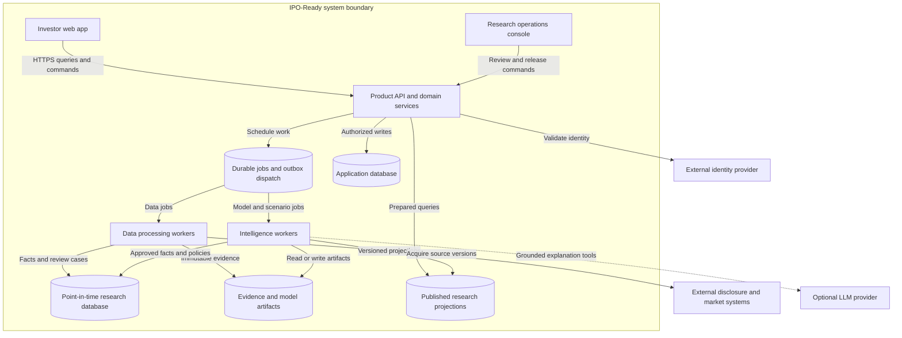
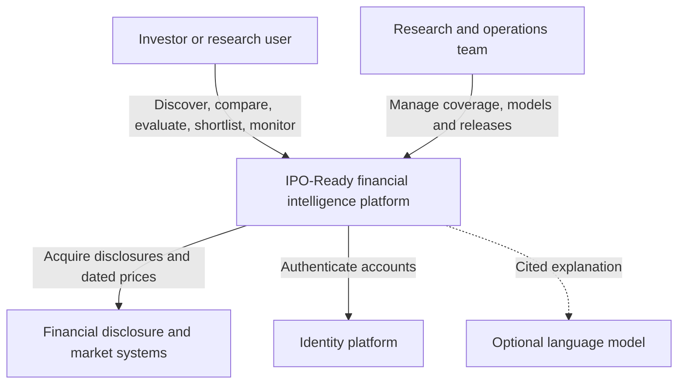
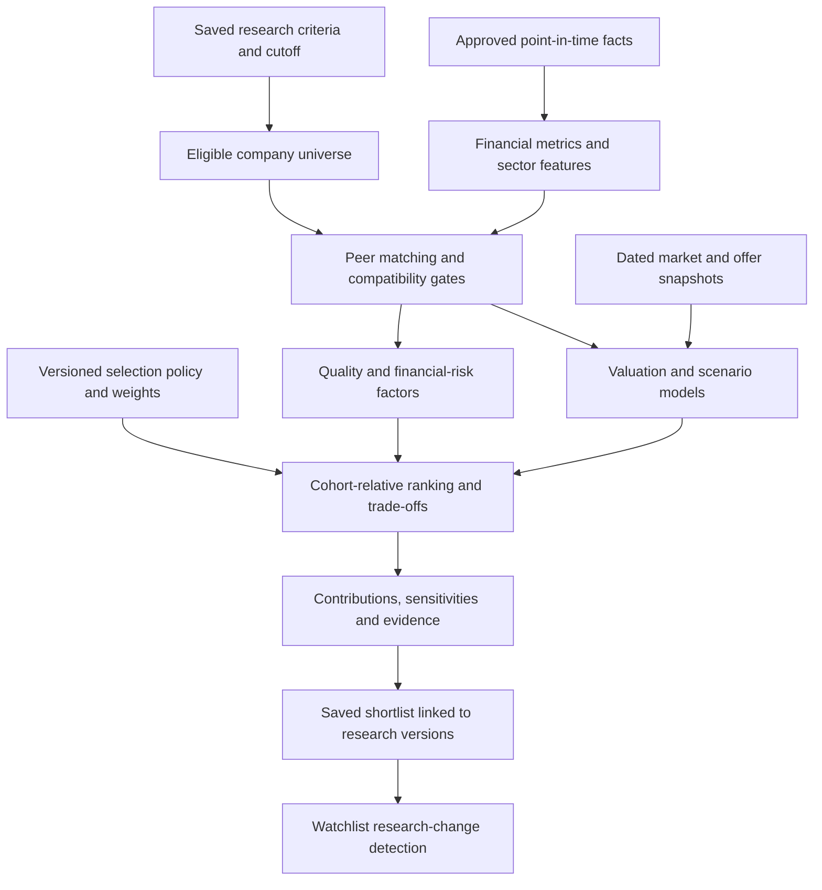
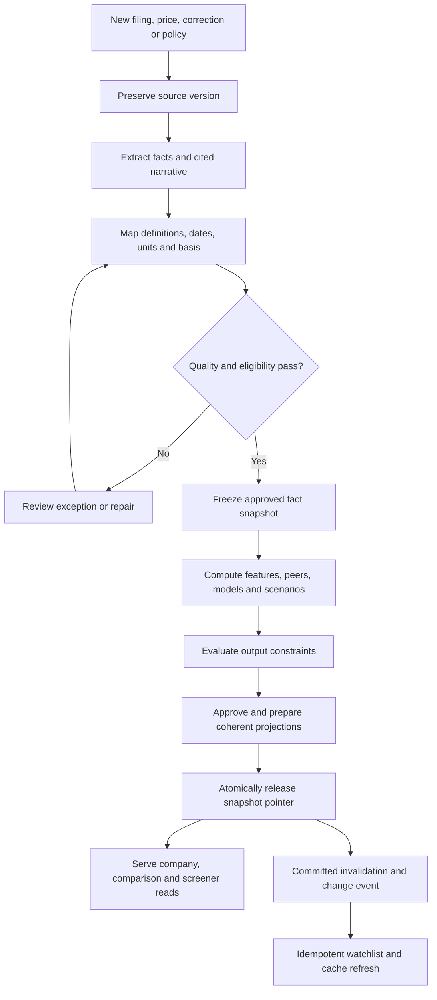
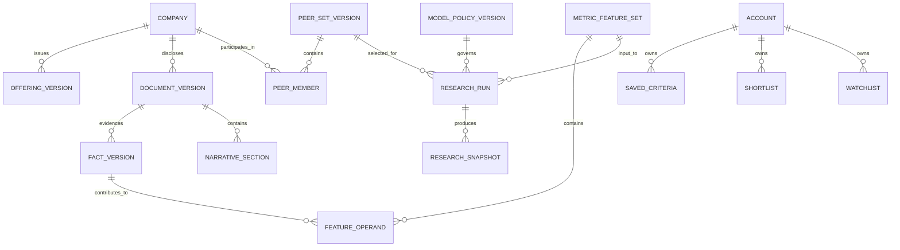

# IPO-Ready: target product Mermaid sources

Revision 2, 29 October 2026. These semantic diagrams complement the seven-view PDF and diagrams.net layout. The design is independent of the GitHub prototype.

## Container architecture

Database nodes can be schemas on one PostgreSQL service. Workers share domain packages but have distinct job types. A durable DB job table is a valid launch queue implementation.

## Product context

## Intelligence and selection

Keep financial quality, risk, valuation and coverage distinct. Cohort and minimum coverage are explicit; missing inputs never silently become zero or a better rank.

## Research lifecycle

## Core data relationships

Run-input association tables also pin market/offer versions, criteria, scenarios and artifacts. Shortlist entries reference exact research versions. These are logical entities, not a complete migration specification.
