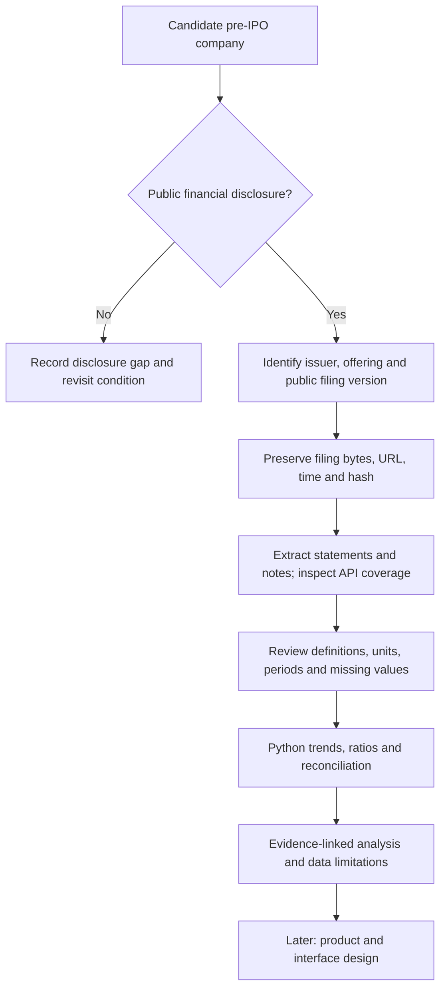

# Initial plan: pre-IPO research with a US-first data pilot

Updated: 2026-10-22. Stage: planning and source feasibility. The user opened the geographic scope to foreign companies and prioritised free APIs. Investors remain the audience and Python analytics remains the academic core. Product design comes later.

## Proposed research question

Can public IPO disclosures be turned into a traceable financial analysis for investors who lack convenient, comparable research on an issuer?

The working target is **companies approaching an IPO with publicly released financial disclosures and limited accessible analysis**. A company with no public financial evidence belongs in a disclosure-gap register; its financial performance cannot be reconstructed reliably from a free API alone. Limited analysis is a hypothesis to test, not a claim that no one has analysed the company.

The user's concern about paid Indian company APIs motivates testing another route. It does not establish that all Indian data is paid: the existing Aether pilot uses public documents. Retain that work as a reference. Begin with US SEC filers, including eligible foreign issuers seeking US offerings; other countries remain possible extensions after their access and accounting requirements are checked.

## Pictorial approach

Every analysis has an explicit public-information cutoff. A historical case reconstructed today is retrospective, even when only pre-offer documents are used.

## What the first source check establishes

| Route | Role in the plan | Evidence and limit |
| --- | --- | --- |
| SEC Submissions JSON | Locate filing history and document names by CIK | U01/U06: live Reddit response succeeded without a key; the retained snapshot includes its original S-1 and three S-1/A rows. Discover unknown issuers through filing indexes, rather than relying on stock tickers. |
| EDGAR filing archive | Obtain the actual IPO statements, notes and offering terms | U02/U06: Reddit's 2024 S-1 index was downloaded. Its full prospectus was not downloaded or financially reconciled in this pass. |
| SEC Company Facts JSON | Candidate source for listed-peer financials; inspect issuer coverage separately | U01/U06: live response succeeded, but its 3,331 observations contain no S-1 form or original S-1 accession. Do not use later reports as substitutes for what was public before an IPO. |
| Public F-1 filings | Extend the US route to eligible foreign issuers | U04: form instructions, PDF p. 3, identify foreign-private-issuer eligibility. Form type alone does not establish an IPO; verify the transaction. Local PDF request returned 403; web-extracted instructions were readable. |
| Issuer website | Supplementary prospectus links and issuer-defined operating indicators | Candidate route only. Verify dates, definitions and provenance for each issuer. |

SEC access is free; extraction, review, hosting and optional AI can still have costs. No paid vendor is required by this proposed pilot. Source details: [U01–U06](../sources/INDEX.md).

Public access has a timing boundary: the reviewed SEC initial-registration procedure allows nonpublic review before public release (U03, section “Securities Act initial public offerings…”). It cannot expose unreleased drafts. Public-reporting status and exchange-listing status are separate fields (U05, “What Is a Public Company?”).

## Analytical design — proposed, not implemented

Start with non-financial operating businesses. Use two reviewed issuer cases for feasibility, then select a small sector-consistent cohort for meaningful comparisons. Banks, insurers, funds, shells and SPAC transactions need separate analytical rules and are outside the first pilot.

| Investor question | Required inputs | Planned calculation or review |
| --- | --- | --- |
| Is the business growing? | Revenue, fiscal dates, comparable periods | Year-on-year growth; CAGR only across valid positive endpoints and actual elapsed years. Do not annualise interim results by default. |
| Is growth profitable? | Gross profit, operating income, net income, revenue | Report each margin separately; retain issuer adjustments and GAAP/IFRS measures separately. |
| Is profit turning into cash? | Operating cash flow, net income, capex | Show cash flow and profit together. OCF/net income only where interpretable; any FCF calculation states its capex definition. |
| What is the liquidity position? | Cash, current assets/liabilities, debt and maturities | Current ratio and debt measures with definitions. A burn/runway estimate requires a reviewed recurring-burn assumption. |
| What can investors learn about the offer? | Dated price range, primary/secondary shares, post-offer share basis, use of proceeds | Separate company proceeds from selling-holder proceeds. Valuation remains unavailable until compatible price/share inputs exist. |
| What changes the interpretation? | Notes, risk factors, stock compensation, related parties, customer concentration | Evidence-linked disclosure review; missing disclosure is recorded explicitly. |

Two years can support a limited comparison; do not assume every issuer discloses three complete years. Loss-making issuers do not receive a meaningful P/E merely because earnings exist. Defer a composite score, return prediction and automated investment recommendation until a target and suitable evaluation data are defined.

Proposed fact fields extend the [existing contract](../data-contract.md): CIK, issuer domicile, listing venue, form, accession, public availability time, draft submission date if known, retrieval time, analysis cutoff, original concept/label, period dates, dimensions, statement basis, accounting standard, reported currency/unit/scale, raw value, evidence anchor and review state. Normalised values and calculations are separate records. Preserve missing, nil, zero, not-applicable and conflict states. Cross-currency absolute comparisons require a dated FX policy; ratios still require definition checks.

## Selecting companies with an analysis gap

The next task is a bounded six-candidate screen, not a global private-company database. For each candidate, record public filing and offering status as of the chosen cutoff, statement coverage, sector, accounting basis, API outcome and extraction difficulty. Include withdrawn offerings in the candidate log rather than selecting only successful IPOs.

Review a fixed set of free company-data pages, issuer material and public research searches. Save query, search date, URLs, paywall/access state, period coverage and whether sources provide statements, ratios or original analysis. “Not found in this bounded search” is the permitted conclusion; “analysis does not exist” is not established. Prefer an issuer where public statements are usable but convenient analysis is limited.

Reddit's 2024 S-1 is an **access-control example**, not a claim of scarce coverage or a currently pre-IPO company. It should not automatically enter the final target cohort.

## Bounded work queue

| Order | Work | Reviewable result | Completion condition |
| --- | --- | --- | --- |
| 1 | Scope and source feasibility | This plan, source records and request manifests | Initial check complete; broad coverage unproven. |
| 2 | Six-candidate screen and analysis-gap audit | Markdown selection matrix; two proposed cases | Both cases have usable public financial disclosures and a recorded selection reason. Include a foreign SEC filer if feasible. |
| 3 | Preserve selected pre-offer filings | Native files, hashes, public release evidence and cutoff | No later disclosure enters the historical input set. An earlier confidential submission date is not its public-availability date. |
| 4 | Design a small reference dataset | 10–15 reviewed base facts per issuer across at least two comparable annual periods where available | Units, definitions, source anchors and unavailable fields recorded. Retain exclusions. |
| 5 | Test analytical feasibility in Python | Notebook, formula dictionary and small reconciliation report | All selected numeric facts are checked to the original disclosure; arithmetic, period selection and missing-value behaviour evaluated separately. |
| 6 | Revisit product design | Updated professor proposal and presentation flow | Evidence from the source and analytical pilots informs design. |

The next action is order 2. This is a work sequence, not a new approval gate. India's deferred XBRL stage 2C and finance-paper deep reading remain available when they answer a current method question.

## Executed evidence and limits

Executed `python research/us_scope_feasibility.py` twice on 2026-10-22: the first run had eight DNS failures; a permitted network retry returned seven HTTP 200 responses and one 403 for the F-1 PDF. The two JSON calls used no key or authentication. The second run preserved source bytes and SHA-256 hashes in [its manifest](../../../research/us_scope_20261022/20261022T115849017612Z/manifest.json).

Executed `python research/us_scope_inspect.py research/us_scope_20261022/20261022T115849017612Z`: metadata inventory only, with [output](../../../research/us_scope_20261022/20261022T115849017612Z/companyfacts_inventory.json). No financial values were validated. One issuer's successful access is not a reliability or pre-IPO coverage benchmark.

For future acquisition, use a declared project user agent with the team's actual contact, cache evidence, and keep requests below the SEC ceiling (U02, “Fair access”). Stop and record access failures. Planning assumption: Python handles retrieval; the SEC API documentation does not support direct browser CORS (U01). No application integration or product redesign was executed here.
